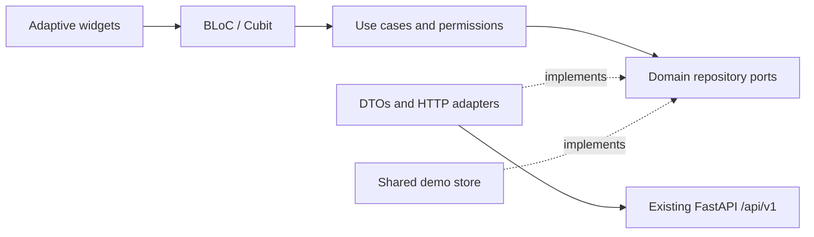

Вот перевод технической документации на русский язык с сохранением всех технических терминов, путей, команд и структур кода в оригинальном виде для удобства разработки:

# HRleaders: Flutter-клиент

Независимый клиент для обратного найма (reverse-hiring) для веб, Android и iOS. Существующее Vue-приложение, API на FastAPI и воркер рекрутинга остаются доступными. Перед изменением адаптера API обязательно прочтите [базовый аудит](../PROJECT_AUDIT.md).

## 🚀 Запуск

Flutter **3.47.6**, Dart **3.13.5**; зависимости зафиксированы в `pubspec.lock`.

```bash
cd flutter-app
flutter pub get --enforce-lockfile
# Моковые данные — безопасный вариант по умолчанию; общая память сохраняется при переключении ролей до перезагрузки.
flutter run -d chrome
# Живой режим должен быть включен явно. Нативные сборки требуют абсолютного HTTPS-URL API.
flutter run --dart-define=HRLEADERS_DEMO=false --dart-define=API_BASE_URL=https://hrleaders.example/api/v1/
flutter build web --release --no-wasm-dry-run
```

Кнопки демо-входа охватывают кандидата, HR, администратора, аналитика и супер администратора. Их электронные почты: `{role}@demo.hrleaders.example`, пароль: `Demo12345`. Эти аккаунты существуют только в демо-адаптере. Зарегистрированные демо-аккаунты используют выбранный пароль. Обновление страницы очищает демо-данные. Настройки темы и локали (ru/en) сохраняются отдельно, без привязки к данным сессии.

## 🏗 Архитектура и поведение

`lib/core` управляет типизированными ошибками/объектами-значениями, HTTP, DI (внедрением зависимостей), правами доступа, маршрутизацией, состояниями ресурсов, общими компонентами, централизованными токенами дизайна и локализацией. Каждая функция имеет слои `domain`, `application`, `data` и `presentation`. Домен и варианты использования (use cases) не зависят от виджетов и транспорта. Только `AppDependencies` выбирает реальную реализацию репозитория или реализацию в общей памяти. Моковый адаптер выбран по умолчанию; живой транспорт требует `--dart-define=HRLEADERS_DEMO=false`.



Каноничный `shadcn_flutter` предоставляет кнопки, поля ввода, селекты, карточки и темы; `shadcn_flutter_material` обеспечивает мост для приложения. Общая светлая/темная палитра использует акцент HRLeaders из Figma `#4028FF`, нейтральные фоны, шрифт JetBrains Mono и общие токены отступов, радиусов и брейкпоинтов. Поверхности как Shadcn, так и Material 3 происходят из одной семантической палитры; настройки темы и локали ru/en сохраняются отдельно без данных сессии. `material_ui` предоставляет поверхности маршрутизации Material, адаптивную навигацию, диалоги, боковые панели (drawers) и таблицы. Компактные макеты используют нижнюю навигацию плюс доступное меню "Еще" (More drawer); планшет использует рельс (rail), а десктоп — боковую панель (sidebar). Диалоги учитывают клавиатуру и безопасные области. Контент прокручивается при больших размерах текста; анимация уважает настройку уменьшенного движения (reduced motion). Шрифты Inter и JetBrains Mono поставляются с их лицензиями OFL.

Лендинг рассказывает историю FIGHT → TAP → NETWORK → CONNECTION → HUG → TRUST → MATCH (БОРЬБА → КАСАНИЕ → СЕТЬ → СВЯЗЬ → ОБЪЯТИЕ → ДОВЕРИЕ → СОВПАДЕНИЕ), со ссылками на регистрацию кандидата/работодателя, информацией о команде, инициалами команды и архитектурой безопасности. Он использует сцену соединения, нарисованную кодом, без внешних фотографий. Весь текст интерфейса находится в парных ARB-файлах (ru/en). Имена, текст профиля и метки словарей, предоставленные сервером, сохраняют свой исходный язык.

| Сценарий | Существующий контракт API |
| --- | --- |
| Вход, регистрация кандидата/HR, восстановление, выход | `auth/login`, `auth/register`, `auth/me`, `auth/logout` |
| Профиль, редактирование, верификация | `candidates/me`, `candidates/me/fsp-sync` |
| Пагинированные фильтры и детали | `candidates`, `candidates/{id}`, `dictionaries` |
| Публикация/закрытие вакансии | `vacancies`, `vacancies/{id}/close` |
| Конкретное предложение по зарплате и ответы | `offers`, `offers/incoming`, `offers/{id}/view`, `/accept`, `/decline`, `/withdraw` |
| Совпадения (Matches) | Проекция принятых предложений; выдуманного эндпоинта совпадений нет |
| Воронка работодателя | `analytics/overview` |

Поиск перезапускается при изменении фильтров и игнорирует устаревшие результаты. Предложения проверяют диапазоны зарплат и право собственности, требуют причину отказа и обеспечивают правильные переходы состояний. Совпадения появляются с обеих сторон только после принятия. Общие состояния ресурсов покрывают загрузку, обновление, пагинацию, пустое состояние, ошибку/повтор и сохранение. Защитники маршрутов (route guards) и варианты использования проверяют права доступа; авторизация на бэкенде остается авторитетной. `hrleaders://candidate/{id}` и `hrleaders://offer/{id}` нормализуются до защищенных маршрутов, сохраняют безопасные локальные назначения через вход в систему и проверяют ID.

## 📜 Основа контракта OpenAPI

`api (2).json` является источником для типизированных транспортных моделей в `lib/core/models/api_models.dart` и полного реестра операций/клиента в `lib/core/network/api_v1_contract.dart`. Перегенерируйте оба файла с помощью `python tool/generate_api_contract.py`. Сгенерированный слой охватывает все 61 схему компонентов и 64 операции, сохраняет неизвестные свойства ответов, проверяет ограничения пути/запроса и идентичность модели тела запроса, а также сохраняет свободные JSON-объекты AI/Recruiting без выдумывания полей. Он оборачивает внедряемый `ApiClient`, но намеренно не подключен к репозиториям функций или запуску приложения; текущие UI-потоки продолжают использовать существующие демо-данные, если живой режим не запрошен явно.

## 🔐 Сессии, транспорт и развертывание

Веб использует HttpOnly cookie бэкенда с аутентифицированными запросами и не хранит JWT в localStorage, настройках или хранилище токенов JavaScript. Нативные платформы используют `flutter_secure_storage` и Bearer-транспорт. Ошибка 401 истекает сессию; выход из системы очищает нативное хранилище даже при сбое транспорта. Контракта обновления (refresh) на бэкенде нет; порт `SessionRenewal` намеренно не реализован.

Используйте проксирование `/api/v1/` с одним источником (same-origin) для развернутых веб-сборок; см. [`deploy/nginx.conf`](deploy/nginx.conf). Обслуживайте HTTPS, сохраняйте продакшн-куки Secure и настройте разрешенные источники (allowed origins) на бэкенде, если требуется кросс-доменная работа. URL API должен указывать на директорию `/api/v1/`. GET-запросы могут повторяться один раз при временных ошибках. Мутации никогда не повторяются автоматически. Отправка и чтение ограничены 15 секундами. Опция `DEBUG_NETWORK=true` в debug-сборках выводит ID запросов, методы и коды состояния без токенов или профилей.

Администрирование только для демо-режима включает метрики аналитика только для чтения, блокировку пользователей, модерацию вакансий, записи аудита, метрики продвижения, статус FSP и выбираемые метрики российских городов на основе атрибутивной геометрии Natural Earth. Демо-уведомления отслеживают предложения, совпадения и верификацию. **На бэкенде нет ролей/API администратора, продвижения, уведомлений, 2FA, метрик шлюза или эндпоинтов истории сессий.** Живые адаптеры возвращают типизированные ошибки о неподдерживаемых операциях и никогда не подменяют демо-данные. Push-уведомления имеют порт провайдера, но не имеют регистрации сервиса/устройства. Детализация конверсии источников, восстановление пароля и истечение срока действия предложений также требуют контрактов с бэкендом. Ни один экран клиента не заявляет о юридическом соответствии или активной 2FA. Детали компании отображают существующее поле идентичности; редактирование требует контракта компании. Обмен сообщениями имеет защищенный порт репозитория и явно пустой демо-входящий ящик. Живой чат и отправка недоступны, пока не существует контракта с бэкендом.

Каркасы Android/iOS и объявления пользовательских схем включены. Нативная компиляция, подписание, поведение secure-store на устройстве и тесты холодного/теплого deep-link ОС требуют соответствующих SDK/устройств. Universal/App Links требуют реального домена развертывания и файлов ассоциации; домен-заглушка не зарегистрирован. Проверки доступности в CI покрывают макеты и масштабирование текста; реальные проверки экранных дикторов и мобильной клавиатуры остаются задачами приемки на устройстве.

## ✅ Проверка

```bash
cd flutter-app
dart format --output=none --set-exit-if-changed lib test
flutter analyze --no-pub
flutter test --no-pub --coverage
flutter build web --release --no-pub --no-wasm-dry-run
cd ..
# При установленном бэкенде в выбранном Python:
examples/test-flutter-api.sh
# Приемка в браузере с использованием существующей установки Playwright на фронтенде:
(cd flutter-app && flutter build web --release --no-pub --no-wasm-dry-run --dart-define=HRLEADERS_DEMO=true --output=build/demo)
python -m http.server 8091 --directory flutter-app/build/demo
# В другом терминале:
node examples/verify-flutter-web.mjs
# Сборка живого режима в build/web, затем проверка реального восстановления куки в браузере:
HRLEADERS_VERIFY_BROWSER=true examples/test-flutter-api.sh
```

Одноразовый живой тест мигрирует SQLite, запускает существующий API и аутентифицированную фикстуру FSP, регистрирует обе стороны, проверяет профиль, выполняет поиск, публикует, отправляет/просматривает/принимает предложение, проверяет общие совпадения/аналитику и закрывает вакансию. Логи сервера/теста находятся в `experiments/issue-9/logs/live-api`. Он останавливается и ждет оба сервера при выходе. Переопределите `HRLEADERS_PYTHON` и `HRLEADERS_FLUTTER`, чтобы использовать явные локальные исполняемые файлы.

Модульные тесты покрывают валидацию домена, проверки прав доступа, жизненный цикл предложений и модерацию. HTTP-тесты покрывают повторные попытки, таймауты, типизированные ошибки, DTO и хранение сессий. Тесты BLoC покрывают устаревшие чтения и пагинацию поиска. Виджет-тесты покрывают ширины 390/768/1440, ru/en, светлую/темную темы, масштабирование текста на 150% и переход от предложения к совпадению. CI сохраняет все существующие проверки Vue/бэкенда/транспорта/браузера и добавляет анализ Flutter, покрытие, тест реального контракта API, адаптивную приемку в браузере, проверку HttpOnly cookie/перезагрузки/выхода и живой релизный веб-артефакт. Скриншоты и отчеты браузера включены в артефакты CI. Зафиксированные визуальные доказательства обобщены в [Flutter verification](../docs/flutter-verification.md).

Регрессии браузера покрыты явно: семантика вложенных маршрутов не может скрыть навигацию оболочки, заголовки разделов остаются отличными от действий, а опции селекта предоставляют реальные действия с целевыми областями касания 48px. Мост Material/shadcn устанавливает каноничное оверлей-меню (drawer) для адаптивных меню селекта. Безопасное для кадров привязывание (frame-safe binding) откладывает уведомления о фокусе веб-представления до макета, поскольку обход в порядке чтения в противном случае запрашивает не размещенный render box в закрепленном SDK; нативные уведомления остаются мгновенными.# HRleaders

