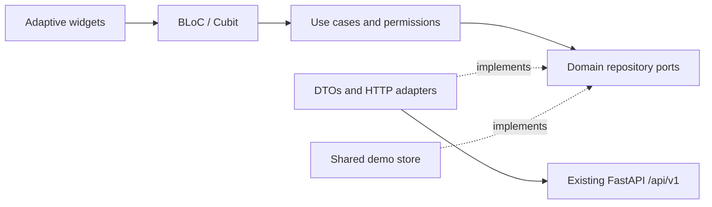

# 🚀 HRleaders: Flutter-клиент

Независимый клиент для обратного найма (reverse-hiring) для веб, Android и iOS. Существующее Vue-приложение, API на FastAPI и воркер рекрутинга остаются доступными.

> ⚠️ **Важно:** Перед внесением изменений в адаптер API обязательно прочтите [базовый аудит](../PROJECT_AUDIT.md).

---

## ⚙️ Запуск

Проект использует **Flutter 3.47.6** и **Dart 3.13.5**. Все зависимости жестко зафиксированы в `pubspec.lock`.

```bash
cd flutter-app
flutter pub get --enforce-lockfile

# 💡 Моковые данные — безопасный вариант по умолчанию. 
# Общая память сохраняется при переключении ролей до перезагрузки.
flutter run -d chrome

# 🌐 Живой режим должен быть включен явно. 
# Нативные сборки требуют абсолютного HTTPS-URL API.
flutter run --dart-define=HRLEADERS_DEMO=false --dart-define=API_BASE_URL=https://hrleaders.example/api/v1/

# 📦 Сборка веб-релиза
flutter build web --release --no-wasm-dry-run
```

**Демо-доступ:**  
Кнопки входа охватывают роли: кандидат, HR, администратор, аналитик и супер-администратор.  
- **Email:** `{role}@demo.hrleaders.example`  
- **Пароль:** `Demo12345`  

> 💡 *Эти аккаунты существуют только в демо-адаптере. Зарегистрированные демо-аккаунты используют выбранный при регистрации пароль. Обновление страницы очищает демо-данные. Настройки темы и локали (ru/en) сохраняются отдельно, без привязки к данным сессии.*

---

## 🏗 Архитектура и поведение

Модуль `lib/core` управляет типизированными ошибками/объектами-значениями, HTTP, DI (внедрением зависимостей), правами доступа, маршрутизацией, состояниями ресурсов, общими компонентами, централизованными токенами дизайна и локализацией. 

Каждая функция разделена на слои: `domain`, `application`, `data` и `presentation`. Домен и варианты использования (use cases) не зависят от виджетов и транспорта. Только `AppDependencies` выбирает между реальной реализацией репозитория и реализацией в общей памяти. Моковый адаптер выбран по умолчанию; живой транспорт требует флага `--dart-define=HRLEADERS_DEMO=false`.



### 🎨 Дизайн и UI
- **Компоненты:** Каноничный `shadcn_flutter` (кнопки, поля ввода, селекты, карточки, темы) + `shadcn_flutter_material` (мост для приложения).
- **Палитра:** Акцент HRLeaders из Figma `#4028FF`, нейтральные фоны, шрифт *JetBrains Mono*, унифицированные токены отступов, радиусов и брейкпоинтов.
- **Адаптивность:** 
  - 📱 *Мобильные:* нижняя навигация + доступное меню «Еще» (More drawer).
  - 📟 *Планшеты:* боковая панель-рельс (rail).
  - 💻 *Десктоп:* полноценная боковая панель (sidebar).
- **Доступность:** Диалоги учитывают клавиатуру и безопасные области. Контент прокручивается при больших размерах текста, анимация уважает настройку уменьшенного движения (reduced motion). Шрифты *Inter* и *JetBrains Mono* поставляются с лицензиями OFL.

### 🌍 Локализация и контент
Лендинг рассказывает историю: **FIGHT → TAP → NETWORK → CONNECTION → HUG → TRUST → MATCH** *(БОРЬБА → КАСАНИЕ → СЕТЬ → СВЯЗЬ → ОБЪЯТИЕ → ДОВЕРИЕ → СОВПАДЕНИЕ)*. Используется программно сгенерированная сцена соединения без внешних фотографий. Весь текст интерфейса хранится в парных ARB-файлах (ru/en). Имена, текст профиля и метки словарей с сервера сохраняют исходный язык.

---

## 📋 Контракты API

| Сценарий | Существующий эндпоинт API |
| :--- | :--- |
| **Аутентификация:** вход, регистрация, восстановление, выход | `auth/login`, `auth/register`, `auth/me`, `auth/logout` |
| **Профиль:** просмотр, редактирование, верификация | `candidates/me`, `candidates/me/fsp-sync` |
| **Поиск:** пагинированные фильтры и детали | `candidates`, `candidates/{id}`, `dictionaries` |
| **Вакансии:** публикация и закрытие | `vacancies`, `vacancies/{id}/close` |
| **Офферы:** предложения по ЗП и ответы на них | `offers`, `offers/incoming`, `offers/{id}/view`, `/accept`, `/decline`, `/withdraw` |
| **Совпадения (Matches):** | Проекция принятых предложений *(специального эндпоинта нет)* |
| **Аналитика:** воронка работодателя | `analytics/overview` |

> 🔍 **Логика работы:** Поиск перезапускается при изменении фильтров и игнорирует устаревшие результаты. Офферы проверяют диапазоны зарплат и право собственности, требуют причину отказа и обеспечивают строгие переходы состояний. Совпадения видны обеим сторонам только после принятия. Защитники маршрутов (route guards) проверяют права, но авторитетной остается авторизация на бэкенде. Deep links (`hrleaders://candidate/{id}`) нормализуются до защищенных маршрутов.

---

## 📜 Основа контракта OpenAPI

Файл `api (2).json` является единственным источником истины для:
1. Типизированных транспортных моделей: `lib/core/models/api_models.dart`
2. Полного реестра операций и клиента: `lib/core/network/api_v1_contract.dart`

**Генерация:**
```bash
python tool/generate_api_contract.py
```
Сгенерированный слой охватывает все **61 схему компонентов** и **64 операции**, сохраняет неизвестные свойства ответов, проверяет ограничения пути/запроса и идентичность модели тела запроса, а также сохраняет свободные JSON-объекты AI/Recruiting без выдумывания полей. Он оборачивает внедряемый `ApiClient`, но намеренно не подключен к репозиториям функций или запуску приложения.

---

## 🔐 Сессии, транспорт и развертывание

- 🌐 **Web:** Использует `HttpOnly` cookie бэкенда с аутентифицированными запросами. JWT **не хранится** в `localStorage`, настройках или JS.
- 📱 **Native:** Использует `flutter_secure_storage` и `Bearer`-транспорт.
- ⏱️ **Таймауты:** Отправка и чтение ограничены 15 секундами. GET-запросы могут повторяться 1 раз при временных ошибках. Мутации **никогда** не повторяются автоматически.
- 🔄 **Сессии:** Ошибка `401` истекает сессию. Выход из системы очищает нативное хранилище даже при сбое транспорта. Контракт обновления (refresh) на бэкенде отсутствует; порт `SessionRenewal` намеренно не реализован.

> 🛡️ **Безопасность развертывания:** Используйте проксирование `/api/v1/` с одним источником (same-origin) для веб-сборок (см. [`deploy/nginx.conf`](deploy/nginx.conf)). Обслуживайте HTTPS, устанавливайте флаг `Secure` для продакшн-куки. URL API должен указывать строго на директорию `/api/v1/`. Опция `DEBUG_NETWORK=true` в debug-сборках выводит ID запросов, методы и коды состояния (без токенов и профилей).

### ⚠️ Ограничения бэкенда (Live vs Demo)
Демо-режим включает метрики аналитика, блокировку пользователей, модерацию, аудит, метрики продвижения, статус FSP и геометрию городов РФ.  
**В реальном бэкенде НЕТ:** ролей/API администратора, продвижения, уведомлений, 2FA, метрик шлюза или эндпоинтов истории сессий. Живые адаптеры возвращают типизированные ошибки о неподдерживаемых операциях и **никогда** не подменяют данные демо-заглушками.

---

## ✅ Проверка и тестирование

```bash
cd flutter-app

# 1. Форматирование и статический анализ
dart format --output=none --set-exit-if-changed lib test
flutter analyze --no-pub

# 2. Модульные и виджет-тесты с покрытием
flutter test --no-pub --coverage

# 3. Сборка веб-релиза
flutter build web --release --no-pub --no-wasm-dry-run
cd ..

# 4. Интеграционный тест с реальным бэкендом (требует установленного Python-окружения)
examples/test-flutter-api.sh

# 5. Приемка в браузере (Playwright)
(cd flutter-app && flutter build web --release --no-pub --no-wasm-dry-run --dart-define=HRLEADERS_DEMO=true --output=build/demo)
python -m http.server 8091 --directory flutter-app/build/demo
# В другом терминале:
node examples/verify-flutter-web.mjs

# 6. Проверка восстановления HttpOnly cookie в живом режиме
HRLEADERS_VERIFY_BROWSER=true examples/test-flutter-api.sh
```

> 🧪 **О одноразовом живом тесте:** Он мигрирует SQLite, запускает существующий API и аутентифицированную фикстуру FSP, регистрирует обе стороны, проверяет профиль, выполняет поиск, публикует вакансию, отправляет/принимает оффер, проверяет совпадения/аналитику и закрывает вакансию. Логи сохраняются в `experiments/issue-9/logs/live-api`. Для использования конкретных исполняемых файлов переопределите переменные `HRLEADERS_PYTHON` и `HRLEADERS_FLUTTER`.

### 📊 Покрытие тестами
- **Unit:** валидация домена, проверки прав, жизненный цикл офферов, модерация.
- **HTTP:** повторные попытки, таймауты, типизированные ошибки, DTO, хранение сессий.
- **BLoC:** устаревшие чтения (stale reads), пагинация поиска.
- **Widget:** ширины 390/768/1440, локали ru/en, светлая/темная темы, масштаб текста 150%, переход от оффера к совпадению.

---

## 🛡️ Гарантия качества и регрессии

Регрессии в браузере покрыты явно:
- Семантика вложенных маршрутов не может скрыть навигацию оболочки.
- Заголовки разделов визуально отделены от действий.
- Опции селекта предоставляют реальные действия с целевыми областями касания **48px**.
- Мост Material/shadcn устанавливает каноничное оверлей-меню (drawer) для адаптивных селектов.
- Безопасное для кадров привязывание (frame-safe binding) откладывает уведомления о фокусе веб-представления до завершения макета, предотвращая запрос не размещенного `render box` в закрепленном SDK (нативные уведомления остаются мгновенными).

*Все артефакты, включая скриншоты и отчеты браузера, сохраняются в CI. Визуальные доказательства обобщены в документе [Flutter verification](../docs/flutter-verification.md).*# HRleaders

