# Flutter client verification

The baseline had no Flutter application. `flutter-app/` adds the client without
replacing the existing Vue application, FastAPI API or recruiting worker.
Architecture, actual backend contracts and assumptions are recorded in
[PROJECT_AUDIT.md](../PROJECT_AUDIT.md). Run instructions and deployment limits
are in [flutter-app/README.md](../flutter-app/README.md).

## Automated acceptance

- Flutter format and analysis: clean.
- Flutter tests: **37 passed**; live API acceptance runs separately. Domain
  validation, role isolation, demo registration/password,
  vacancy/offer ownership and lifecycle, shared matches/analytics, moderation,
  DTOs/dictionaries, secure-token handling, HTTP retry/timeout/expiry, resource
  states and stale search pagination, accessible selects on desktop/Android,
  frame-safe web focus, nested-navigation semantics, responsive search at
  390/768/1440 in ru/en and light/dark with 150% text, and offer-to-match widgets.
- `examples/test-flutter-api.sh`: disposable migrated SQLite, real FastAPI and
  authenticated existing FSP fixture; register both roles, profile edit/sync,
  filtered search, vacancy, offer/view/accept, both-side matches, analytics and
  vacancy closure. The default unit run skips this test; the script runs it.
- `HRLEADERS_VERIFY_BROWSER=true examples/test-flutter-api.sh`: real browser
  registration, profile editing/FSP, existing HttpOnly/SameSite=Lax cookie,
  reload session restoration, absence of JWTs in browser storage, and logout.
- `examples/verify-flutter-web.mjs`: actual Chromium UI, both locales/themes and
  three widths, publication, vacancy selection, concrete salary/message offer,
  acceptance, shared match, analytics, selectable Russia map and keyboard focus.
  Unexpected console errors fail the check. Reduced motion is enabled.
- Existing checks: 15 repository tests; backend lint/type checks and 154 tests
  with PostgreSQL/real NATS; Vue lint/type/build and 60 unit tests; 8 existing
  Playwright flows; all 60 rendered Figma exports.

CI retains all previous jobs and adds locked Flutter dependencies, analysis,
coverage, real API/browser acceptance, demo browser screenshots and a **live**
release web artifact. Run logs are saved under `experiments/issue-9/logs/` locally
and verification evidence is uploaded as a CI artifact.

## Regressions found during browser review

1. The nested Navigator's route semantics hid sidebar navigation and preference
   buttons from the accessibility tree. The shell now contains the child route
   in its own semantics container; a widget test checks the controls directly.
2. Initial web view-focus notification reached reading-order traversal before
   layout and produced `RenderBox was not laid out`. The binding dispatches web
   focus notifications after layout, preserving their order. A binding test
   verifies observers receive laid-out geometry; browser startup must be clean.
3. Plain `SelectItem` contents rendered but supplied no selection action. The
   shared wrapper now uses canonical `SelectItemButton` controls with 48px
   minimum height. The bridge also installs `DrawerOverlay` so adaptive mobile
   selection has the required ancestor. The reproducing test failed with
   `Expected: true; Actual: false` for the tap action; desktop and Android
   tests now check semantic activation and the changed value.
4. A section heading and subtitle were merged into its refresh action. Separate
   heading/subtitle semantics now preserve each label; the match widget test
   reproduces and verifies this accessibility regression.

Browser CI run `37815709790` (commit `646a5bb`) exposed a test input race.
Preserved log lines 1234–1239 show
the dialog-close timeout; its screenshot shows `200000250000` after the helper
attempted to replace the prefilled `200000` with `250000`. Flutter establishes
its editing connection after focus is processed on a frame. The shared browser
helper now waits for focused frames, verifies select-all and clearing, then
checks the exact typed value after blur. It uses keyboard input and keeps the
existing timeouts. Failure screenshots/page state are saved in CI artifacts.
`FLUTTER_BROWSER_CPU_RATE=4 node experiments/issue-9/reproduce-browser-edit.mjs`
checks five replacements with a finite slowdown; `--legacy` retains the old
interaction for investigation (the race is timing-dependent).

Before and after selection-menu evidence:

| Before: inert text rows | After: actionable selection rows |
| --- | --- |
| 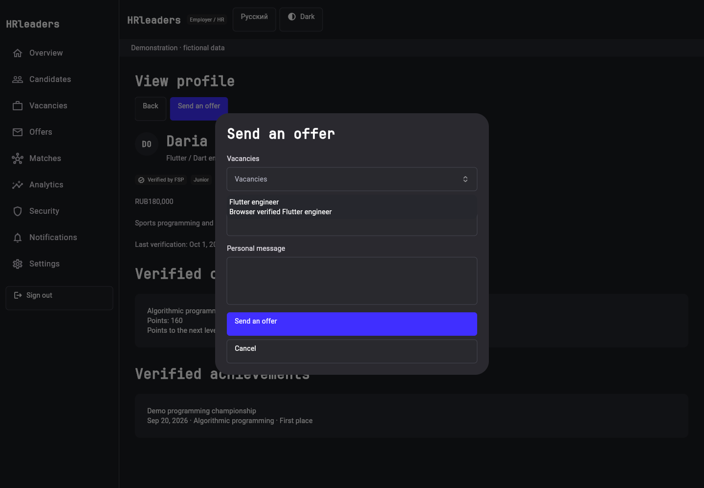 | 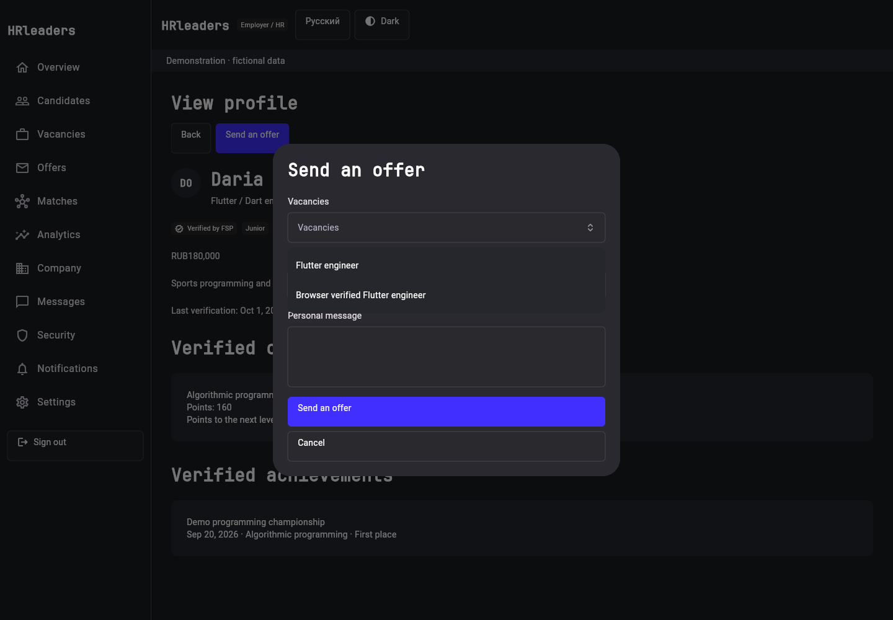 |

## Visual evidence

All screenshots use explicit fictional demo data. They are review evidence,
not claims that missing production services are deployed.

| Desktop landing · ru · light | Mobile landing · ru · light |
| --- | --- |
| 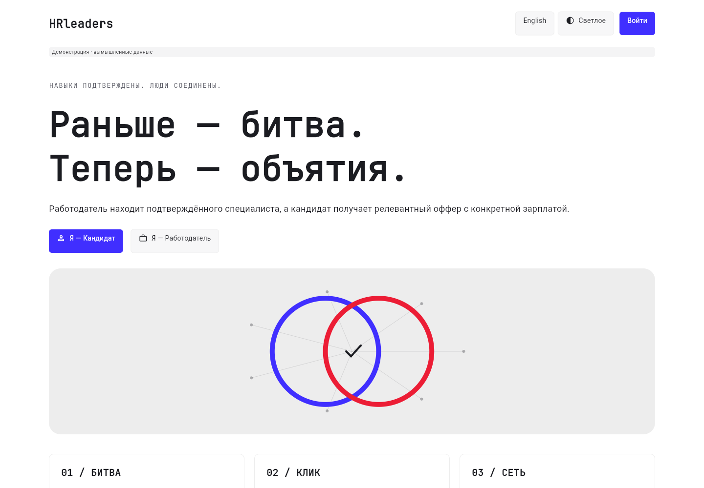 | 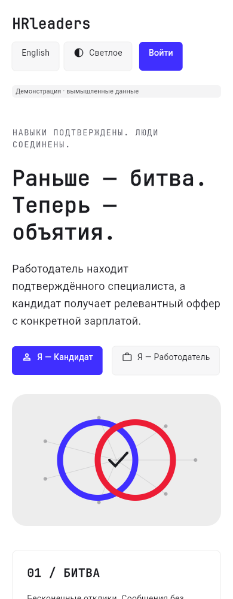 |

| Desktop search · en · dark | Tablet search · ru · light | Mobile search · en · dark |
| --- | --- | --- |
| 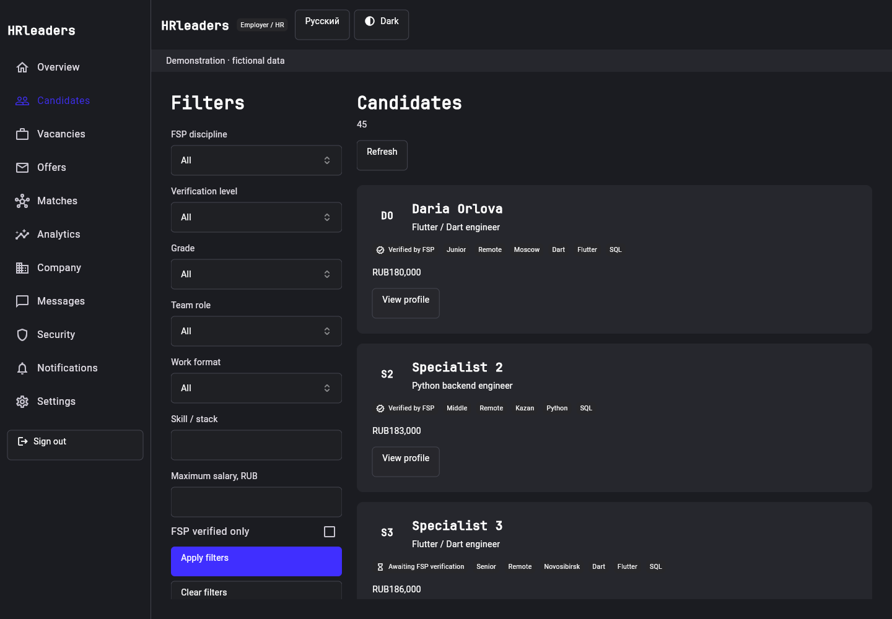 | 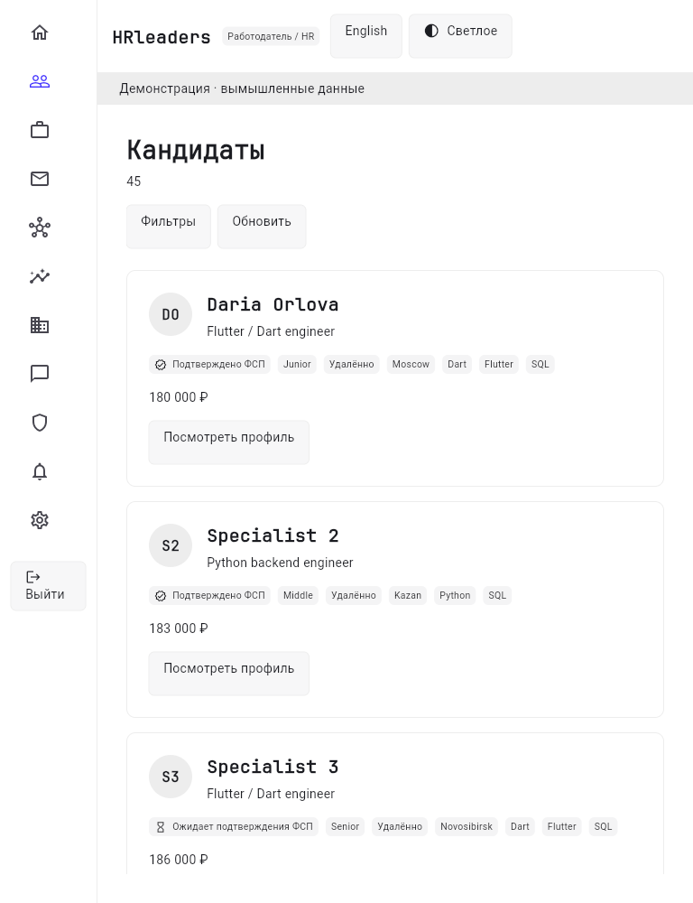 | 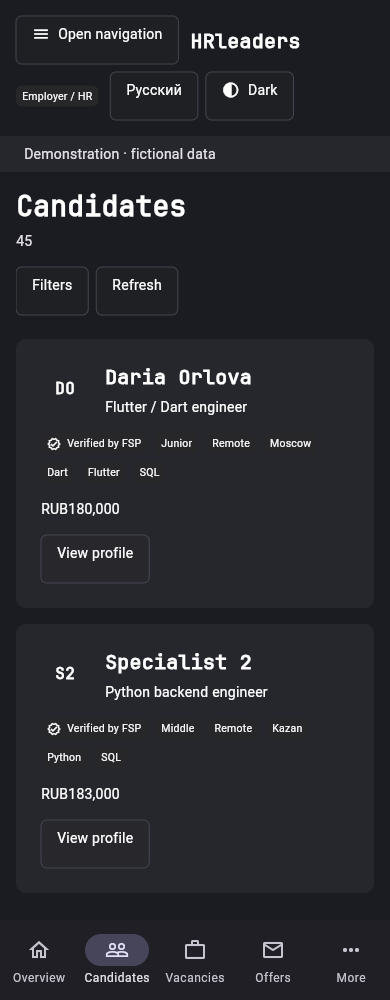 |

| Concrete offer | Accepted match | Mobile match |
| --- | --- | --- |
| 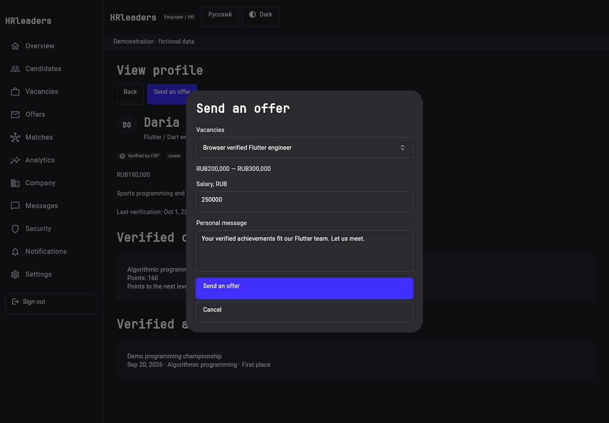 | 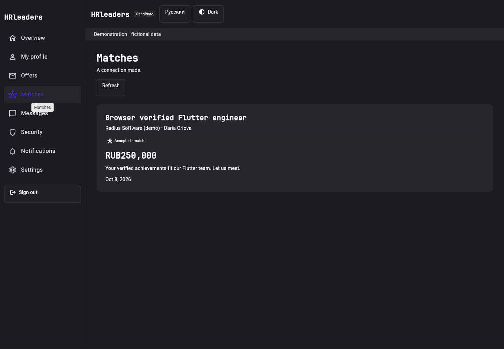 | 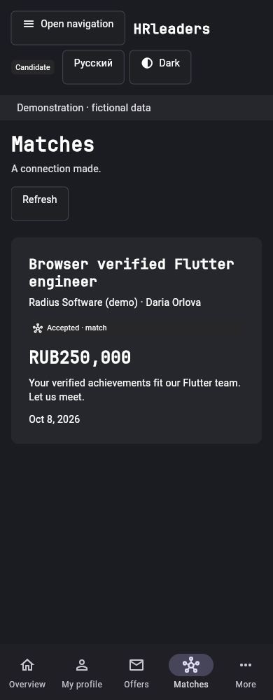 |

| Administration · en · dark | Administration · ru · mobile |
| --- | --- |
| 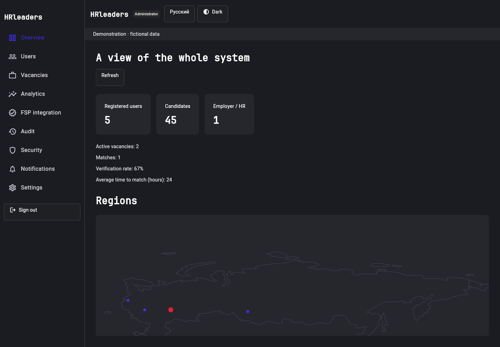 | 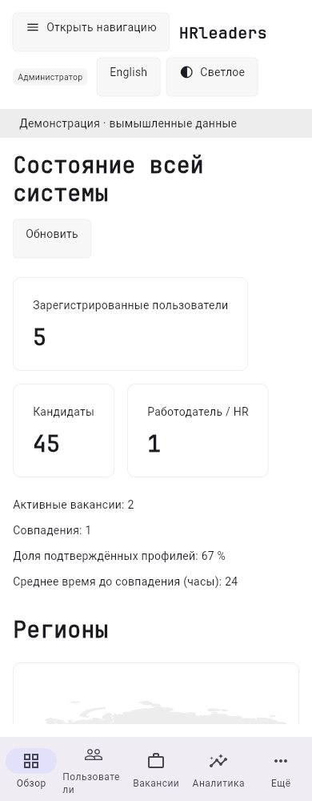 |

## Deployment acceptance still needed

Android/iOS builds, signing, secure-storage device behavior, screen readers,
mobile keyboards and OS cold/warm deep links need native SDKs/devices.
Universal/App Links need a deployment domain and association files.
Backend contracts are still required for administration roles/API, promotion,
chat, company editing, notifications/push registration, renewal, recovery,
2FA/session history and offer expiry. Unsupported live adapters never replace
errors with demo data, and the UI makes these limits visible.
