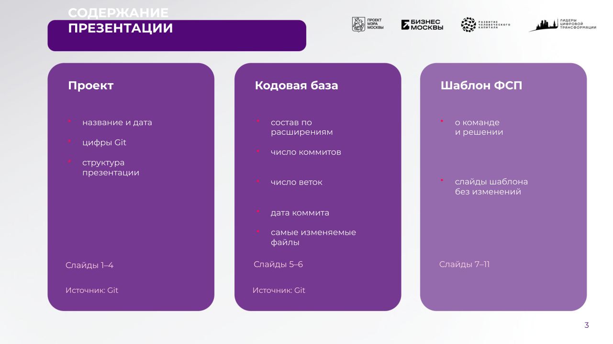
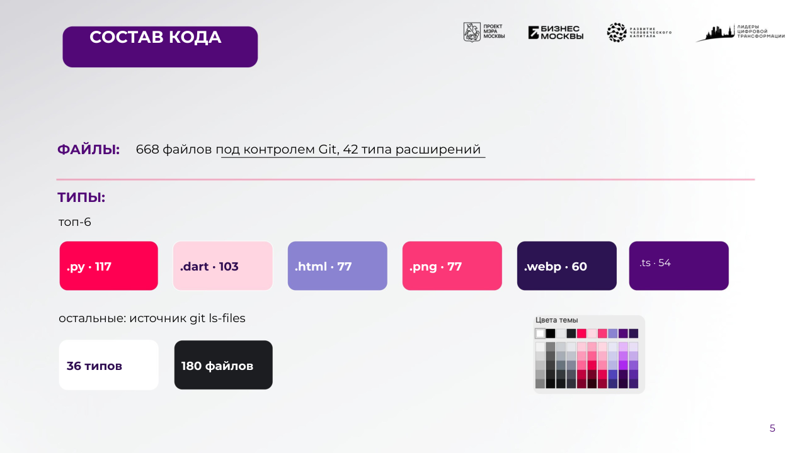
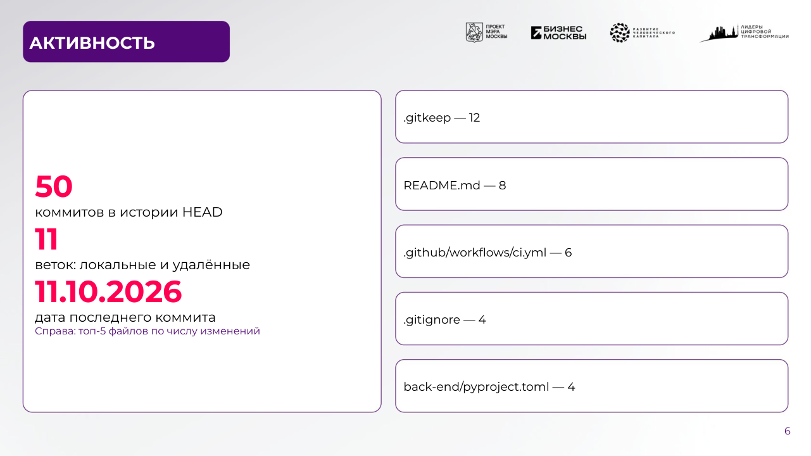

# Презентация ФСП: генерация из шаблона и данных Git

Для [issue #8](https://github.com/leaderstat/hr-lzt-2026/issues/8) реализован весь
конвейер: сбор фактов из Git → `repo_stats.json` → анализ шаблона → `SLIDE_SPEC` →
сборка PPTX → структурная проверка → визуальная проверка → итоговый отчёт.

Результат: [`presentation/HRleaders.pptx`](presentation/HRleaders.pptx) (11 слайдов),
отчёты и рендеры слайдов — в [`presentation/report/`](presentation/report/).

| | |
|---|---|
|  |  |
|  |  |
|  |  |

## Шаблон

В репозитории есть только PDF-версия шаблона ФСП (20 страниц). Поэтому
`tools/fsp_pdf_template.py` один раз переводит её в редактируемый
[`templates/ЛЦТ_2026_Шаблон презентации ФСП.pptx`](../templates/README.md):
фон каждой страницы (картинки и векторная графика без текста), текстовые блоки на
исходных местах с исходным размером, цветом и жирностью (шрифт Montserrat указан
на 5-й странице шаблона), пустые карточки — именованные области `region:N`.
Дизайн не меняется: генератор правит только текст.

Слайды результата берутся из страниц шаблона `1, 2, 3, 4, 5, 20, 7, 8, 9, 10, 11`:
6-я страница шаблона содержит только логотипы партнёров без текстовых областей,
поэтому для слайда «Активность» используется страница 20 с карточками.

## Запуск

```bash
pip install -r tools/requirements-presentation.txt   # нужно только для визуальной QA
python -m tools.fsp_presentation \
  --repo-path . \
  --templates-dir templates \
  --report-dir /tmp/fsp-report-001 \
  --output docs/presentation/HRleaders.pptx \
  --presentation-name HRleaders \
  --soffice /path/to/soffice    # необязательно, иначе ищется в PATH
```

Каталог отчётов должен быть новым. Создаются `repo_stats.json`,
`template_inspection.json`, `slide_spec.json`, `status.json` и `render/slide-NN.png`.
Код возврата: 0 — `GENERATED`, 1 — QA не пройдена, 2 — генерация заблокирована
(нет шаблона, shallow clone и т. п.). Без `--output` выполняется только анализ.

## Содержание слайдов (только данные Git)

1. Название (`--presentation-name` или имя репозитория), слоган из заголовка
   `README.md` в HEAD, дата последнего коммита.
2. Обзор: файлы в индексе, коммиты HEAD, участники, типы файлов, ветки.
3. Содержание презентации.
4. Без изменений (служебный слайд шаблона).
5. Состав кода: топ-6 расширений в цветных плашках, остальные типы и файлы.
6. Активность: коммиты, ветки, дата последнего коммита и топ-5 изменяемых файлов.
7–11. Frozen: шаблон без изменений — состав команды, контакты и описание решения в
   Git не записаны, придумывать их нельзя.

## Проверки

* **Структурная** (`structural_qa`): 11 слайдов, размер слайда, frozen-слайды
  побайтно равны шаблону, геометрия и media всех слайдов не изменены, все правки
  `SLIDE_SPEC` применены.
* **Визуальная** (`tools/fsp_visual_qa.py`): LibreOffice рендерит результат и
  шаблон; каждая строка текста должна оставаться внутри своего блока и слайда, тексты
  разных блоков не должны пересекаться, frozen-слайды должны совпадать с рендером
  шаблона. Замечания, которые уже есть в самом шаблоне, не считаются новыми.

```bash
python -m unittest discover -s tests -v
ruff check --config back-end/pyproject.toml tools tests
ruff format --check --config back-end/pyproject.toml tools tests
mypy --strict tools
```

## Источники данных

Файлы — индекс Git (`git ls-files --stage -z`), без `.git`, `node_modules`, `dist`,
`build`, `coverage`. Коммиты, дата и изменяемые файлы — история HEAD. Участники —
все локальные refs с mailmap. Ветки — локальные и remote refs без `origin/HEAD`.
Shallow checkout отклоняется. `provenance` в `repo_stats.json` фиксирует HEAD и
область каждого подсчёта; отчёт описывает коммит, на котором был запущен.
