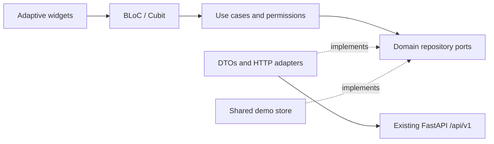

# HRleaders Flutter client

Independent reverse-hiring client for web, Android and iOS. The existing Vue
application, FastAPI API and recruiting worker remain available. Read the
[baseline audit](../PROJECT_AUDIT.md) before changing an API adapter.

## Run

Flutter **3.47.6**, Dart **3.13.5**; dependencies are locked in `pubspec.lock`.

```bash
cd flutter-app
flutter pub get --enforce-lockfile
# Mock data is the safe default; shared memory survives role switching until reload.
flutter run -d chrome
# Live mode must be explicitly enabled. Native builds require an absolute HTTPS API URL.
flutter run --dart-define=HRLEADERS_DEMO=false --dart-define=API_BASE_URL=https://hrleaders.example/api/v1/
flutter build web --release --no-wasm-dry-run
```

Demo login buttons cover candidate, HR, administrator, analyst and superadmin.
Their emails are `{role}@demo.hrleaders.example`, password `Demo12345`.
These accounts only exist in the demo adapter. Registered
demo accounts use their chosen password. Refreshing the page clears demo data.
Theme and ru/en locale preferences persist separately without session data.

## Architecture and behavior

`lib/core` owns typed failures/value objects, HTTP, DI, permissions, routing,
resource states, shared components, centralized design tokens and localization.
Each feature has `domain`, `application`, `data` and `presentation` layers.
Domain and use cases are independent of widgets and transport. Only
`AppDependencies` selects the real or shared-memory repository implementation.
The mock adapter is selected by default; live transport requires
`--dart-define=HRLEADERS_DEMO=false`.



Canonical `shadcn_flutter` supplies buttons, inputs, selects, cards and themes;
`shadcn_flutter_material` supplies the app bridge. The shared light/dark palette
uses the HRLeaders Figma accent `#4028FF`, neutral backgrounds, JetBrains Mono,
and common spacing, radius and breakpoint tokens. Both Shadcn and Material 3
surfaces are derived from the same semantic palette; theme and ru/en locale
preferences persist separately without session data. `material_ui` supplies
Material routing surfaces, adaptive navigation, dialogs, drawers and tables.
Compact layouts use bottom navigation plus an accessible More drawer; tablet
uses a rail and desktop a sidebar. Dialogs account for the keyboard and safe
areas. Content scrolls at large text sizes; animation respects reduced motion.
Inter and JetBrains Mono are bundled with their OFL licenses.

The landing tells FIGHT → TAP → NETWORK → CONNECTION → HUG → TRUST → MATCH,
with candidate/employer registration links, about, team initials and security
architecture. It uses a code-drawn connection scene without external photos.
All interface copy lives in paired ru/en ARB files. Server-supplied names,
profile text and dictionary labels retain their original language.

| Flow | Existing API contract |
| --- | --- |
| Login, candidate/HR registration, restore, logout | `auth/login`, `auth/register`, `auth/me`, `auth/logout` |
| Profile, edit, verification | `candidates/me`, `candidates/me/fsp-sync` |
| Paginated filters and details | `candidates`, `candidates/{id}`, `dictionaries` |
| Publish/close a vacancy | `vacancies`, `vacancies/{id}/close` |
| Concrete salary offer and responses | `offers`, `offers/incoming`, `offers/{id}/view`, `/accept`, `/decline`, `/withdraw` |
| Matches | Accepted-offer projection; no invented matches endpoint |
| Employer funnel | `analytics/overview` |

Search restarts on filter changes and ignores stale results. Offers validate
salary ranges and ownership, require a decline reason and enforce transitions.
Matches appear on both sides only after acceptance. Shared resource states
cover loading, refresh, pagination, empty, error/retry and saving. Route guards
and use cases check permissions; backend authorization remains authoritative.
`hrleaders://candidate/{id}` and `hrleaders://offer/{id}` normalize to guarded
routes, preserve safe local destinations through login and validate IDs.

## OpenAPI contract groundwork

`api (2).json` is the source for typed transport models in
`lib/core/models/api_models.dart` and the complete operation registry/client
in `lib/core/network/api_v1_contract.dart`. Regenerate both with
`python tool/generate_api_contract.py`. The generated layer covers all 61
component schemas and 64 operations, preserves unknown response properties,
checks path/query constraints and request-body model identity, and retains
free-form AI/Recruiting JSON objects without inventing fields.
It wraps the injectable `ApiClient` but is intentionally not wired into
feature repositories or app startup; current UI flows continue using the
existing demo data unless live mode is explicitly requested.

## Sessions, transport and deployment

Web uses the backend HttpOnly cookie with credentialed requests and does not
store JWTs in localStorage, preferences or JavaScript token storage. Native
uses `flutter_secure_storage` and Bearer transport. A 401 expires the session;
logout clears native storage even on transport failure. There is no backend
refresh contract; the `SessionRenewal` port is intentionally unimplemented.

Use same-origin `/api/v1/` proxying for deployed web builds; see
[`deploy/nginx.conf`](deploy/nginx.conf). Serve HTTPS, keep production cookies
Secure, and configure backend allowed origins when cross-origin operation is
required. The API URL must point to the directory `/api/v1/`. GET requests may
retry once on transient errors. Mutations never retry automatically. Sending
and reading are bounded by 15 seconds. Opt-in `DEBUG_NETWORK=true` in debug
builds emits request IDs, methods and status codes without tokens or profiles.

Demo-only administration includes read-only analyst metrics, user blocking,
vacancy moderation, audit entries, promotion metrics, FSP status and selectable
Russian city metrics over attributed Natural Earth geometry. Demo notifications
track offers, matches and verification. **The backend has no admin roles/API,
promotion, notification, 2FA, gateway metrics or session-history endpoints.**
Live adapters return typed unsupported failures and never substitute demo data.
Push notifications have a provider port but no service/device registration.
Source-conversion breakdowns, password recovery and offer expiration also need
backend contracts. No client screen claims legal compliance or active 2FA.
Company details display the existing identity field; editing needs a company
contract. Messaging has a guarded repository port and an explicitly empty demo
inbox. Live chat and sending are unavailable until a backend contract exists.

Android/iOS scaffolds and custom-scheme declarations are included. Native
compilation, signing, secure-store device behavior and OS cold/warm deep-link
tests require the respective SDKs/devices. Universal/App Links require a real
deployment domain and association files; no placeholder domain is registered.
Accessibility checks in CI cover layouts and text scaling; real screen-reader
and mobile keyboard checks remain device acceptance tasks.

## Verify

```bash
cd flutter-app
dart format --output=none --set-exit-if-changed lib test
flutter analyze --no-pub
flutter test --no-pub --coverage
flutter build web --release --no-pub --no-wasm-dry-run
cd ..
# With the backend installed in the selected Python:
examples/test-flutter-api.sh
# Browser acceptance, using the front-end's existing Playwright installation:
(cd flutter-app && flutter build web --release --no-pub --no-wasm-dry-run --dart-define=HRLEADERS_DEMO=true --output=build/demo)
python -m http.server 8091 --directory flutter-app/build/demo
# In another terminal:
node examples/verify-flutter-web.mjs
# Build live mode into build/web, then verify real browser cookie restoration:
HRLEADERS_VERIFY_BROWSER=true examples/test-flutter-api.sh
```

The disposable live test migrates SQLite, launches the existing API and
authenticated FSP fixture, registers both sides, verifies a profile, searches,
publishes, sends/views/accepts an offer, checks shared matches/analytics and
closes the vacancy. Server/test logs are under `experiments/issue-9/logs/live-api`.
It stops and waits for both servers on exit. Override `HRLEADERS_PYTHON` and
`HRLEADERS_FLUTTER` to use explicit local executables.

Unit tests cover domain validation, permission checks, offer lifecycle and
moderation. HTTP tests cover retries, timeout, typed failures, DTOs and session
storage. BLoC tests cover stale reads and search pagination. Widget tests cover
390/768/1440 widths, ru/en, light/dark, 150% text scaling and offer-to-match.
CI keeps all existing Vue/backend/transport/browser checks and adds Flutter
analysis, coverage, the real API contract test, responsive browser acceptance,
HttpOnly cookie/reload/logout verification and a live release web artifact.
Browser screenshots and reports are included in CI artifacts. Committed visual
evidence is summarized in [Flutter verification](../docs/flutter-verification.md).

Browser regressions are covered explicitly: nested route semantics cannot
hide shell navigation, section headings stay distinct from actions, and select
options expose real actions with 48px touch
targets. The Material/shadcn bridge installs the canonical drawer overlay for
adaptive select menus. A frame-safe binding defers web view-focus notifications
until layout because initial reading-order traversal otherwise queries an
unlaid-out render box in the pinned SDK; native notifications remain immediate.
